<div align="center">

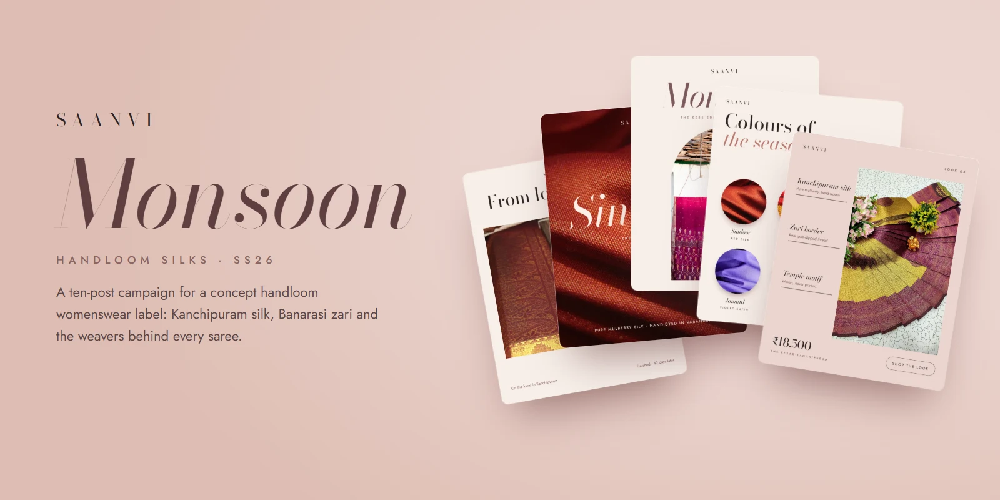

<br>

# Saanvi Atelier

**Posts and stories for a concept handloom womenswear label.**
Kanchipuram silk, Banarasi zari and the weavers behind every saree, set in Bodoni editorial type.


[**See it live on my portfolio →**](https://guru1315-portfolio.vercel.app/graphic-designer)

</div>

---

## The brief

Saanvi is a fictional womenswear label that works directly with handloom weaving families in Kanchipuram and Varanasi. Indian ethnic-wear ads tend to be loud: crowded layouts, heavy gold and big discounts. Saanvi's campaign treats a saree the way a fashion house treats couture: **quiet editorial type, lots of space, and the cloth itself as the hero.** Half the campaign sells the look; the other half sells the hands that made it.

> *"Six weeks on one loom."*

## The campaign

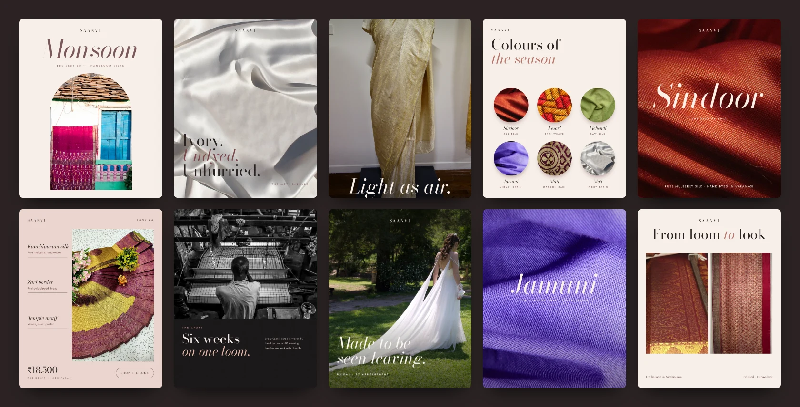

| # | Post | The job it does |
|:-:|---|---|
| 01 | **Monsoon** | The season opener: a Chanderi silk drying outside a village home, framed in an arch. |
| 02 | **Ivory. Undyed. Unhurried.** | The quiet capsule, sold in three words over raw silk. |
| 03 | **Light as air.** *(story)* | Tissue silk with gold zari, as a full-screen story. |
| 04 | **Colours of the season** | The palette post: six swatches, each with a Hindi colour name. |
| 05 | **Sindoor** | The festive edit, set over hand-dyed red silk. |
| 06 | **The Kesar Kanchipuram** | The product post: callouts for silk, zari border and temple motif, plus the price. |
| 07 | **Six weeks on one loom.** | The craft story: one weaver, one saree. |
| 08 | **Made to be seen leaving.** | Bridal, by appointment. |
| 09 | **Jamuni** *(story)* | The evening edit in violet satin, with a *Swipe up* call to action. |
| 10 | **From loom to look** | Side by side: the saree on the loom, then finished, 42 days later. |

<details>
<summary><b>View every post full size</b></summary>
<br>

<p align="center">
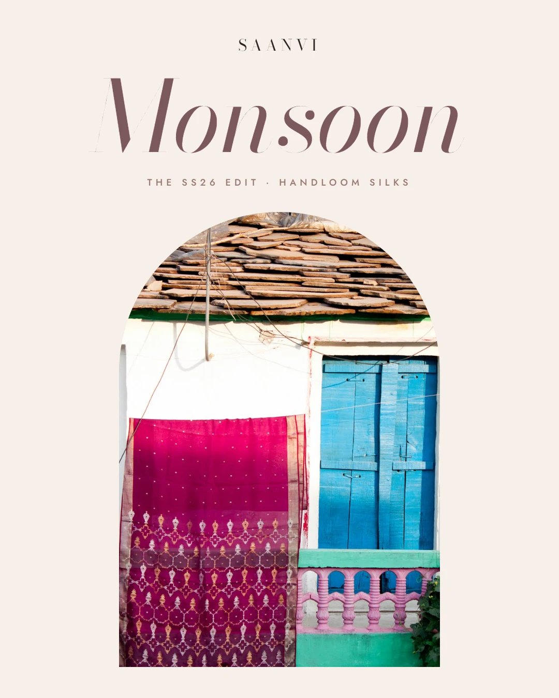
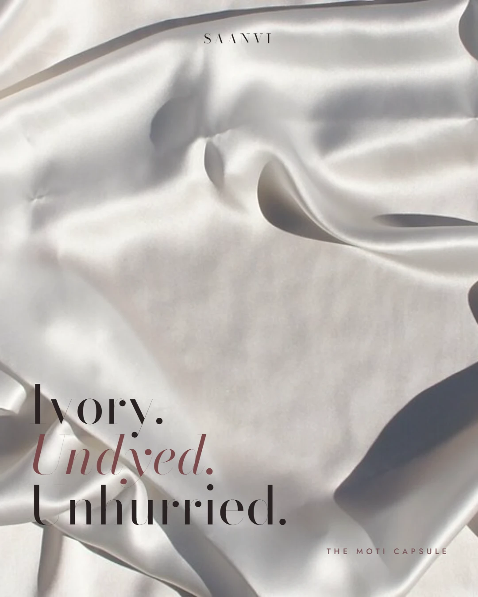
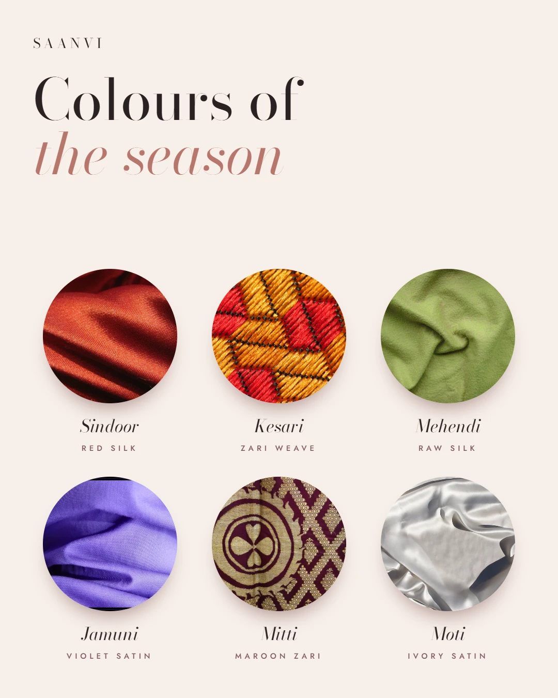
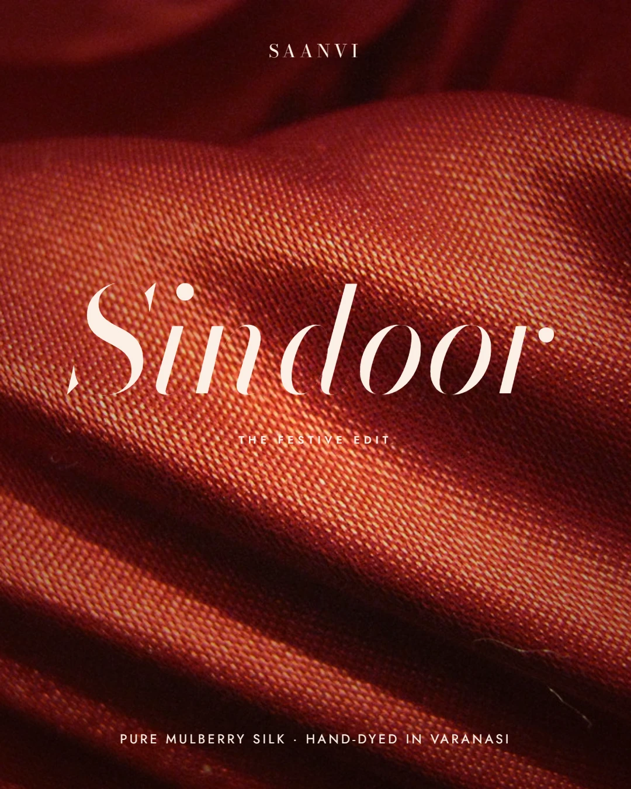
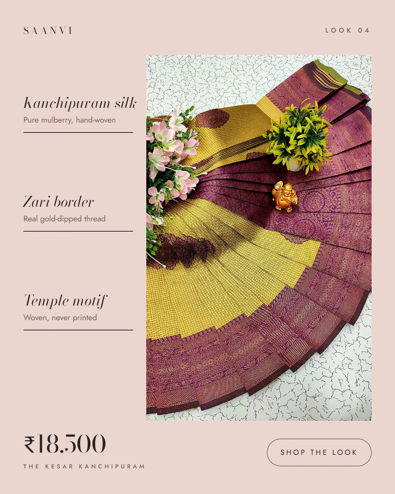
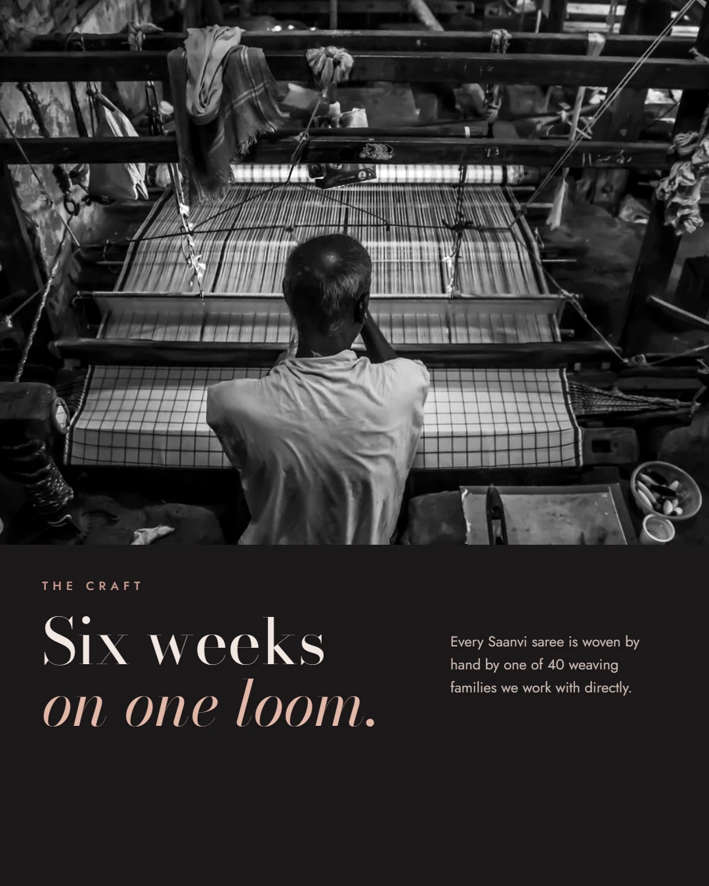
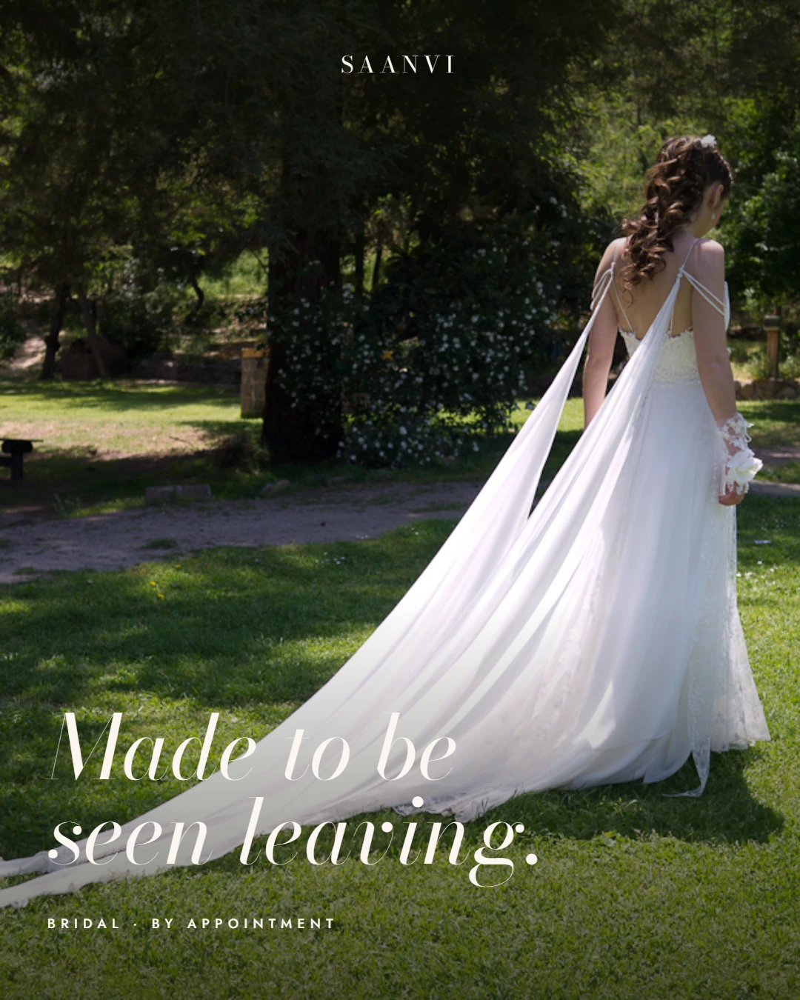
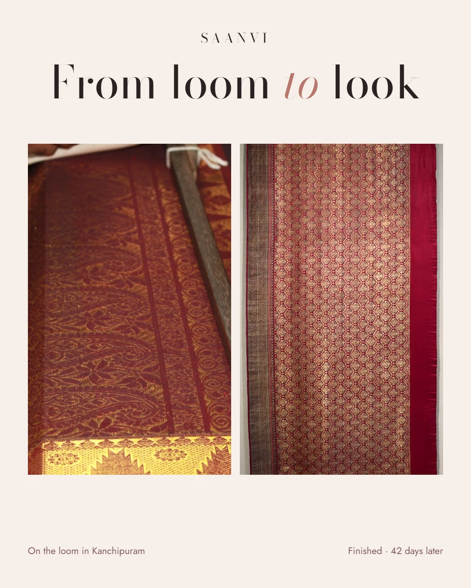
</p>

**Stories (9:16)**

<p align="center">
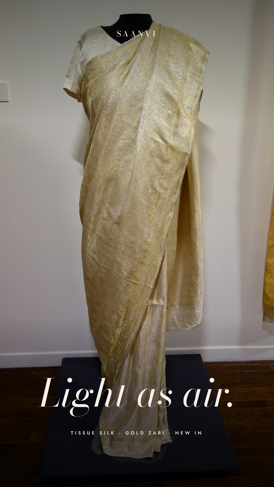
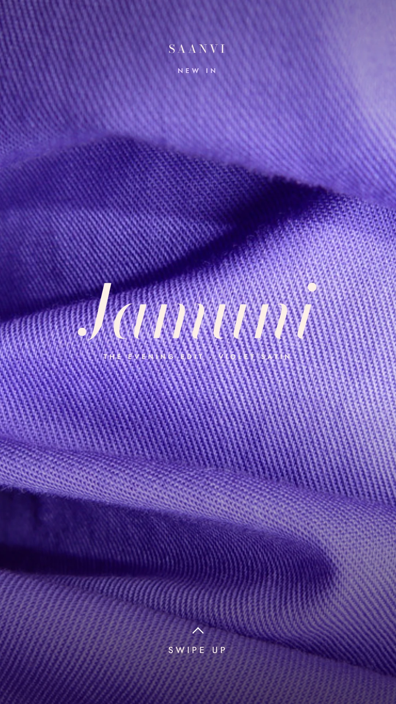
</p>

</details>

## Brand identity

<p align="center">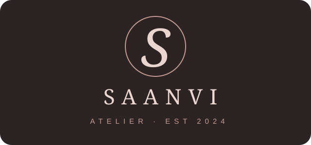</p>

**The mark** is a single italic Bodoni *S* inside a hairline circle, like a monogram stitched onto a garment label. The spaced SAANVI wordmark and the small ATELIER · EST 2024 line give it the feel of a couture house ([logo on silk](brand/logo-on-photo.webp)).

### Colour

| | Name | Hex | Used for |
|:-:|---|---|---|
|  | Ivory | `#F7EFE9` | Editorial backgrounds |
|  | Blush | `#EBD5CF` | Product and callout posts |
|  | Rose clay | `#B9786F` | Italic highlights |
|  | Mauve | `#7E5A5C` | Headlines, labels |
|  | Ink | `#2B2324` | Body type, dark posts |

### Type

- **[Bodoni Moda](https://fonts.google.com/specimen/Bodoni+Moda)** (Regular with *Italic*): the wordmark and every headline. High contrast, like a fashion magazine masthead.
- **[Jost](https://fonts.google.com/specimen/Jost)** (400–500, widely spaced caps): labels, fabric details and prices.

### The rules the campaign follows

1. **The cloth is the hero.** No faces lead a post. Weave, drape and border do the selling.
2. **Name colours the way weavers do.** Sindoor, Kesari, Mehendi, Jamuni, Mitti, Moti.
3. **Every product post names three real details** (silk, border, motif) before it shows a price.
4. **Craft gets equal space.** For every look there is a post about the loom or the hands behind it.

## Repository

```
Saanvi-Atelier/
├── campaign/        8 posts (1080 × 1350) and 2 stories (1080 × 1920), WebP
├── brand/           logo.svg and the logo on silk
├── assets/          README banner and campaign grid
└── CREDITS.md       photographers, museums and licences
```

## Credits

**Concept, art direction, copy and design:** Guru Charan.

Saanvi Atelier is a **concept brand** made for this portfolio. It isn't a real label, and the products, prices and figures are fictional.

The photography is free-licence material from [Openverse](https://openverse.org) and [Wikimedia Commons](https://commons.wikimedia.org) (CC BY and CC0), including museum photographs of antique Varanasi saris whose designs are in the public domain. Every photo was cropped, colour-graded and designed over, and every photographer is credited in **[CREDITS.md](CREDITS.md)**.

<div align="center">
<br>

**[Portfolio](https://guru1315-portfolio.vercel.app)** · **[More graphic design work](https://guru1315-portfolio.vercel.app/graphic-designer)** · **[Aranya Living](https://github.com/Guru1315/Aaranya-Living)** · **[Kaelum Springs](https://github.com/Guru1315/kaelum-springs)**

</div>
